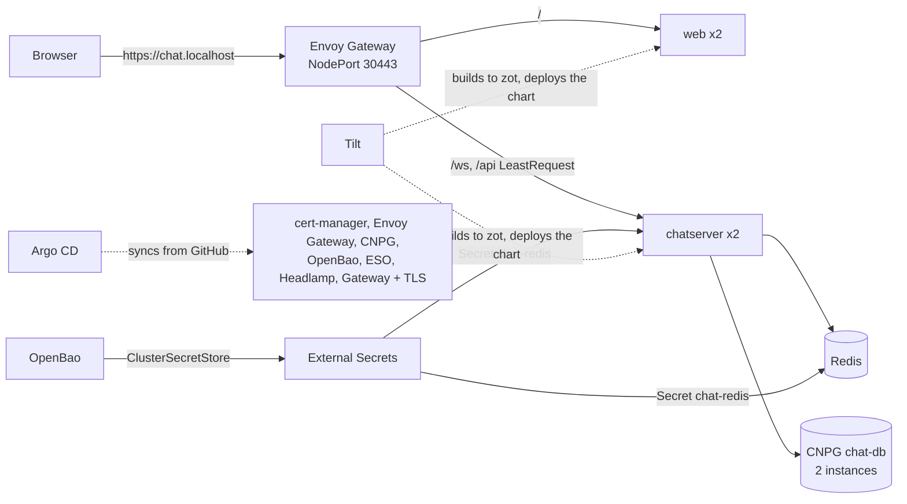

# Kubernetes on kind

The same chat runs on a local three-node Kubernetes cluster. Envoy Gateway takes the place of the Go load balancer, CloudNativePG runs PostgreSQL, and the Redis password comes from OpenBao through External Secrets. Argo CD owns the platform; Tilt owns the app namespace while you develop.



## Prerequisites

- Colima running with the default 14 GB (`just colima`), and `mise install` for tofu, kind, kubectl, helm, tilt and k9s.
- The repository checked out under your home directory. Colima shares `$HOME` with the VM, and kind mounts `infra/local/containerd/certs.d` into its nodes from there.
- The branch you deploy pushed to GitHub. Argo CD syncs the platform from the repository, not from your working tree.

## Quickstart

```bash
just cluster      # kind + zot + Argo CD, then waits for the platform and configures OpenBao
just trust-ca     # once per machine: trust the local CA in the macOS login keychain
just dev          # Tilt: builds the images into zot and deploys the chart
open https://chat.localhost
```

`just cluster` takes 5 to 10 minutes the first time. With the observability stack it uses about 7 GB of the 14 GB Colima VM.

| URL | What | Login |
| --- | --- | --- |
| <https://chat.localhost> | The chat | any username |
| <https://argocd.chat.localhost> | Argo CD | `admin` / `just argocd-password` |
| <https://headlamp.chat.localhost> | Headlamp | `just headlamp-token` |
| <https://bao.chat.localhost> | OpenBao UI | token `root` (dev mode) |

`just k9s` opens k9s on the same cluster.

## How it fits together

- **OpenTofu, `infra/local`:**
  - Creates the kind cluster, pinned by image digest. Only `127.0.0.1:443` is published, to Envoy's NodePort 30443.
  - Starts the zot registry container on the `kind` network.
  - Installs Argo CD and the root Application.
  - Loads the local CA into cert-manager.
- **Argo CD, `deploy/argocd/platform`:** an app-of-apps Helm chart with sync waves. Operators and CRDs come first (cert-manager, Envoy Gateway, CloudNativePG, OpenBao, External Secrets). Then come the gateway, the wildcard certificate and the tool routes from `deploy/platform/config`, then Headlamp, and last the OpenBao ClusterSecretStore.
- **OpenTofu, `infra/secrets`:** configures OpenBao over a short port-forward:
  - A `chat` kv mount, holding the Redis password.
  - A read policy.
  - A Kubernetes auth role for the External Secrets service account.
- **Tilt, `Tiltfile`:**
  - Builds `chat-chatserver` and `chat-web` and pushes them to zot at `localhost:5001`.
  - Renders `deploy/helm/chat` with `values-dev.yaml`.
  - Holds chatserver back until the CNPG cluster and the `chat-redis` ExternalSecret are Ready.
- **TLS:** `scripts/local-ca.sh` creates one CA per machine in `~/.local/share/chat-localhost`. Its name constraints allow only `chat.localhost`, its subdomains and loopback IPs, so its key cannot mint a certificate your Mac would trust for any other site. cert-manager issues `chat.localhost` and `*.chat.localhost` from it.

### Graceful drain behind Envoy

On a rolling update or a pod deletion:

1. The chat server turns `/readyz` red, and Kubernetes removes the pod from the EndpointSlice Envoy reads.
2. After `CHAT_DRAIN_DELAY` (5s), the server closes sockets with 1001.
3. Browsers reconnect through Envoy to a remaining pod and reload history.

`just e2e-drain` proves this against the cluster.

## Observability and SRE

Argo CD also installs a full observability stack in the `observability` namespace:

- kube-prometheus-stack (Prometheus, Alertmanager, Grafana);
- Loki, Tempo and Pyroscope;
- an OpenTelemetry Collector;
- the blackbox exporter, Pyrra and KEDA;
- ntfy and Mailpit.

| URL | What |
| --- | --- |
| <https://grafana.chat.localhost> | Grafana; user `admin`, password from `just grafana-password`. Open the "Chat" dashboard. |
| <https://prometheus.chat.localhost> | Prometheus |
| <https://alertmanager.chat.localhost> | Alertmanager |
| <https://pyrra.chat.localhost> | SLOs and error budgets |
| <https://ntfy.chat.localhost> | Subscribe to `chat-alerts` for pages, or `chat-heartbeat` for the Watchdog |
| <https://mailpit.chat.localhost> | Alert emails |

**How the signals flow:**

- Each chatserver pod sends OTLP to the Collector:
  - traces go to Tempo;
  - metrics go to Prometheus's OTLP receiver;
  - logs go to Loki's OTLP endpoint.
- Profiles go straight to Pyroscope.
- Envoy starts every trace at the gateway, so a single trace covers the request from the edge, through Redis, to each server that delivers the message.
- In Grafana you can jump from a trace to its logs and to the matching CPU profile.

**SLOs and alerts:**

- Pyrra turns two SLOs into multi-window burn-rate alerts:
  - 99.5% of handshakes and HTTP requests without a 5xx;
  - 99% of Redis fan-outs under 250 ms.
- The chart also pages on "no chatserver replica available" and on failing blackbox probes.
- Alertmanager sends everything to ntfy and to Mailpit. The always-firing `Watchdog` goes to the `chat-heartbeat` topic, so you can see that delivery works.

**Autoscaling:**

- KEDA scales chatserver between 2 and 6 replicas, targeting 50 open sockets per pod.
- `just load` runs a k6 WebSocket test through Envoy (150 users by default; `just load 300` for more). Watch the "Replicas" panel climb while it runs.
- Existing sockets stay where they are. New ones go to the least busy pod, because Envoy balances with LeastRequest.
- When the load stops, KEDA scales back down after its cooldown. The drained pods close their sockets with 1001, and clients reconnect.

On macOS, `just load` needs the CA trusted (`just trust-ca`), because Go on macOS ignores `SSL_CERT_FILE`.

## GitOps mode

`just gitops` hands the app to Argo CD as well. It deploys `deploy/helm/chat` from `main` with the signed GHCR images into the `chat-gitops` namespace, at <https://gitops.chat.localhost>. `just gitops-off` removes it. The two modes use different namespaces and hostnames, so they never fight over the same objects.

## Commands

| Command | What it does |
| --- | --- |
| `just cluster [rev] [repo]` | Create or update everything; `rev` defaults to the current branch |
| `just cluster-down` | `tofu destroy`; the zot volume stays as a cache |
| `just platform-wait` | Wait for every platform Application to be Synced and Healthy |
| `just cluster-secrets` | Re-apply the OpenBao configuration |
| `just dev` / `just dev-ci` | Tilt interactive / one-shot |
| `just k8s-smoke` | Health, config, SPA and history through Envoy over HTTPS |
| `just e2e` | Two WebSocket clients exchange a message; history contains it |
| `just e2e-drain` | Rolling restart under an open socket expects close 1001 and a reconnect |
| `just tofu-lock` | Provider lock files for macOS and Linux |
| `just load [vus]` | k6 WebSocket load through Envoy; fails unless KEDA scales chatserver out |
| `just obs-check` | Asserts that metrics, traces, logs, profiles, the dashboard, SLO rules and alert notifications all arrived |
| `just grafana-password` | Grafana admin password |

CI runs the same sequence in `.github/workflows/k8s-e2e.yaml` on every pull request that touches the app, the chart, the platform or the infrastructure. The Dagger `manifests` and `tofu` checks lint the charts, validate every manifest against the Kubernetes 1.36 and CRD schemas, and validate both OpenTofu roots.

## Troubleshooting

- **`push <branch> first`:** Argo CD pulls the platform manifests from GitHub. Push the branch, or pass a pushed one: `just cluster main`.
- **After a Colima restart:**
  - `externalsecret/chat-redis` reports a sync error: OpenBao runs in dev mode and lost its data. The existing Secret keeps the app running. Run `just cluster-secrets`, and the password comes back unchanged from Tofu state.
  - If the cluster itself does not come back, run `just cluster-down && just cluster`.
- **Port 443 is taken:** `TF_VAR_https_port=8443 just cluster`, then use `https://chat.localhost:8443` and `just k8s-smoke https://chat.localhost:8443`.
- **Safari cannot find `chat.localhost`:** Chrome, Firefox and curl resolve `*.localhost` to loopback by themselves. Safari may not, so use another browser or add the hosts to `/etc/hosts`.
- **Firefox does not trust the certificate:** enable `security.enterprise_roots.enabled` in `about:config` so Firefox reads the macOS keychain.
- **Image pull errors for `localhost:5001/...`:** check that the registry container runs (`docker ps --filter name=kind-registry`) and that the repository is under `$HOME`, so the `certs.d` mount reaches the nodes.
- **GitOps mode cannot pull from GHCR:** packages pushed by the release workflow can start out private. Make `chat-chatserver` and `chat-web` public in the GitHub package settings.
